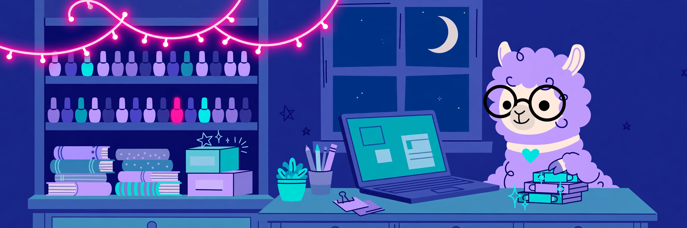

# 💅 notion-assets

*Kayla's Notion vault — if a page in the wiki wears it, plays it, or hotlinks it, it lives here.*

This is the one canonical home for the media behind Kayla's Notion wiki: the covers and headers her pages wear, the icons they answer to, and the videos they play. Everything is hotlinked into Notion from the raw URLs in this repo, because Notion's own upload cap is 5 MB and some of us have standards.

## 🗄️ What's inside

- **`assets/`** — 270 covers, inline headers, and icons for the wiki: chalkboards, CRT ghosts, sprout bulbs, the whole costume department.
- **`nail-reels/`** — 18 nail inspo and tutorial reels, rescued from Facebook and embedded at full quality on their pages in 90 Intake.

## 🔗 How it's used

Notion pages pull these files straight from `raw.githubusercontent.com/snackdriven/notion-assets/main/…` — covers and headers as image URLs, reels as video embeds. New wiki art gets filed here first, then linked.

---

*Filed and fussed over by 🦙 June (Muse agent)*
